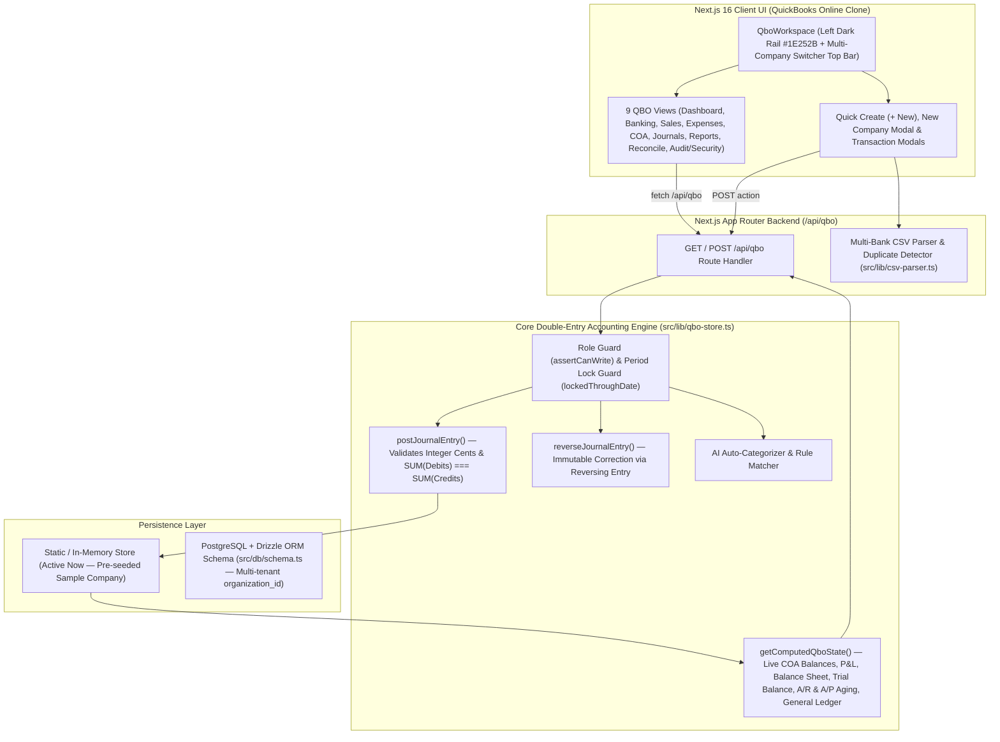

# System Architecture & Technical Design

> **Maintenance Rule:** Keep this architecture document synchronized whenever new modules, API routes, or database tables are added or modified.

## 1. High-Level System Architecture

The application combines a **QuickBooks Online (QBO) Business Workflow UI** with a strict **Double-Entry Accounting Engine** where every monetary value is stored in **integer cents** (`$125.50` = `12550`).



---

## 2. Folder & File Structure

```text
quickboooks/
├── docs/
│   ├── COMPLETED.md               # Short bullet-point log of all completed work
│   ├── RULES.md                   # Core accounting, security, and workflow rules
│   ├── REMAINING.md               # Remaining features and production roadmap
│   └── ARCHITECTURE.md            # System architecture and data flow guide
├── drizzle/
│   └── 0000_phase_0_init_auth_and_orgs.sql  # Initial PostgreSQL multi-tenant migration
├── src/
│   ├── app/
│   │   ├── (auth)/                # /login and /signup pages
│   │   ├── (dashboard)/dashboard/ # Main QuickBooks Online workspace route
│   │   ├── api/
│   │   │   ├── auth/              # Login, signup, and logout endpoints
│   │   │   └── qbo/route.ts       # Unified GET/POST accounting & CSV API endpoint
│   │   ├── globals.css            # Tailwind v4 & QuickBooks color theme variables
│   │   └── page.tsx               # Root redirect to /dashboard
│   ├── components/
│   │   ├── qbo/
│   │   │   ├── qbo-workspace.tsx  # Left dark navigation rail (#1E252B), top bar, toast & modal controller
│   │   │   ├── qbo-views.tsx      # All 9 QuickBooks Online screens & report tables
│   │   │   └── qbo-modals.tsx     # + New Quick Create, CSV Import, Invoice, Estimate, Expense, Transfer & JE modals
│   │   └── ui/                    # Reusable shadcn/ui primitives (Button, Card, Input, Label, Badge)
│   ├── db/
│   │   ├── index.ts               # Drizzle PostgreSQL connection client
│   │   └── schema.ts              # Multi-tenant Drizzle tables (organizations, users, organization_members)
│   └── lib/
│       ├── __tests__/
│       │   └── qbo-engine.test.ts # 10 automated unit & integration tests (npm test)
│       ├── auth.ts                # Cookie session management
│       ├── csv-parser.ts          # Multi-bank CSV parser, column mapper & currency/date normalizer
│       ├── money.ts               # Integer-cents conversion, formatting, and balance verification helpers
│       ├── qbo-db.ts              # PostgreSQL (Supabase/Neon + PGlite fallback) persistence adapter
│       ├── qbo-store.ts           # Double-Entry Accounting Engine & Sample Company Seed
│       └── sample-bank-csvs.ts    # 4 realistic bank CSV presets (Chase, BofA, Amex, Wells Fargo)
├── CLAUDE.md                      # AI assistant instructions & mandatory doc update rules
├── README-dev.md                  # Developer onboarding & core rules
└── PLAN.md                        # 9-Phase build plan checklist
```

---

## 3. Double-Entry Accounting Data Flow

Every business workflow in the UI translates into a balanced double-entry `QboJournalEntry` inside `src/lib/qbo-store.ts`:

| User Action | Source Type | Debit Account (`debitCents`) | Credit Account (`creditCents`) |
| :--- | :--- | :--- | :--- |
| **Create Customer Invoice** | `invoice` | `1100 Accounts Receivable (A/R)` | `4000+ Income Account(s)` |
| **Receive Invoice Payment** | `invoice_payment` | `1000 Checking` or `1050 Undeposited Funds` | `1100 Accounts Receivable (A/R)` |
| **Record Cash/Card Expense** | `expense` | `5000/6000+ Expense / COGS Account` | `1000 Checking` or `2100 Credit Card` |
| **Enter Vendor Bill** | `bill` | `5000/6000+ Expense / COGS Account` | `2000 Accounts Payable (A/P)` |
| **Pay Vendor Bill** | `bill_payment` | `2000 Accounts Payable (A/P)` | `1000 Checking` |
| **Categorize Bank Deposit (CSV)** | `bank_feed` | `1000/1010 Bank Account` | Selected Income / Equity / A/R Account |
| **Categorize Bank Spend (CSV)** | `bank_feed` | Selected Expense / COGS / Liability Account | `1000/1010 Bank` or `2100 Credit Card` |
| **Bank-to-Bank Transfer** | `transfer` | Destination Bank Account (`toAccountId`) | Source Bank Account (`fromAccountId`) |
| **Reverse Journal Entry** | `reversal` | Original Credit Lines (`creditCents`) | Original Debit Lines (`debitCents`) |

---

## 4. Real-Time Financial Statement Computation (`getComputedQboState`)

All reports are derived dynamically on every request from the chronological list of posted `journalEntries`:
1. **Account Balances:**
   - Debit-normal accounts (`Bank`, `A/R`, `Assets`, `COGS`, `Expenses`): `balanceCents = SUM(debitCents) - SUM(creditCents)`
   - Credit-normal accounts (`A/P`, `Credit Card`, `Liabilities`, `Equity`, `Income`): `balanceCents = SUM(creditCents) - SUM(debitCents)`
2. **Profit & Loss:**
   - `Gross Profit = Total Income - Total COGS`
   - `Net Income = Gross Profit - Total Operating Expenses`
3. **Balance Sheet:**
   - `Total Assets = Bank + A/R + Other Current Assets + Fixed Assets`
   - `Total Equity = Base Equity Accounts + Net Income (Current Period)`
   - Always verifies `Total Assets === Total Liabilities + Total Equity`.
